# Guide pratique — IDE et aides-soignant(e)s

*Suivi des mesures d'isolement et de contention — les gestes du quotidien, pas à pas. Les captures sont faites en mode démonstration, avec des données fictives.*

L'outil ne remplace pas le dossier patient informatisé (DPI) : la prescription et la surveillance clinique y restent. Ici, vous **reportez les décisions du psychiatre** (début, pause, reprise, fin) et vous **tracez** ce que la loi demande : information du tiers, communications au juge des libertés et de la détention (JLD), professionnels présents auprès du patient. Les échéances sont calculées pour vous.

> Les noms des onglets et des lieux peuvent différer légèrement dans votre établissement (par exemple « chambre d'isolement » au lieu de « chambre de soins intensifs (CSI) »). Selon l'organisation locale, certaines actions peuvent être réservées à d'autres fonctions.

## 1. Se connecter

Ouvrez le lien de l'outil, saisissez votre identifiant et votre mot de passe, laissez **Données réelles** coché, puis **Se connecter**. Le *Mode formation* sert à s'entraîner sur des données fictives.

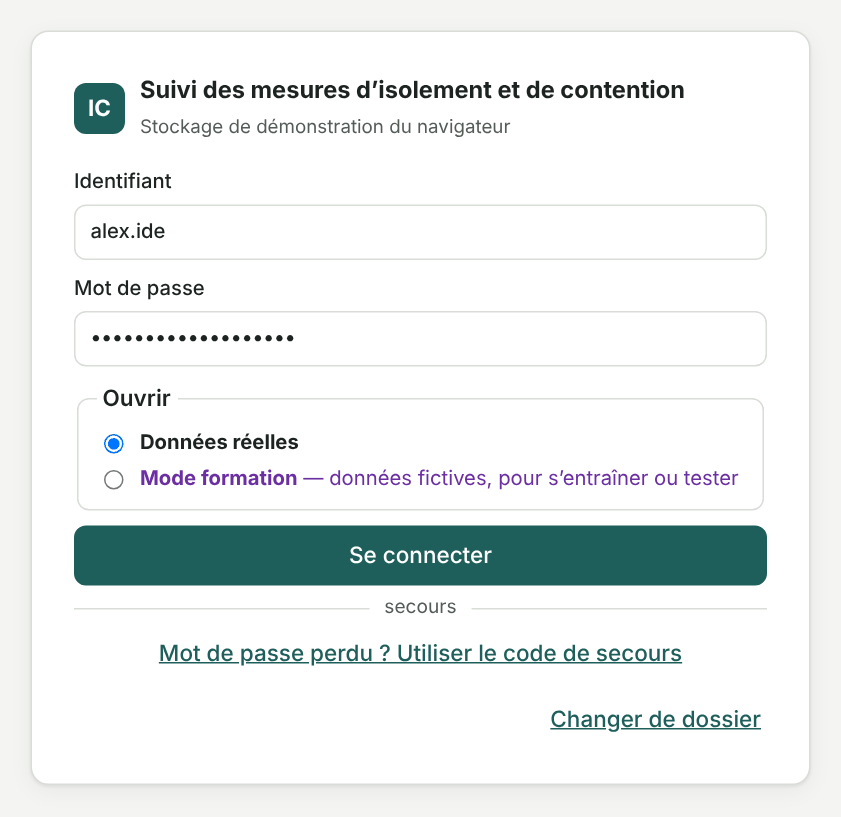

*Écran de connexion. Un compte est personnel : ne le prêtez pas, verrouillez le poste en partant (bouton « Verrouiller »).*

## 2. Le tableau de bord

C'est la première page. Il résume ce qui demande votre attention : mesures en cours, **échéances JLD** proches ou dépassées, **tiers à renseigner**, **postes de surveillance incomplets**, points de vigilance (cumuls élevés, patient en soins libres…). Les boutons *Saisir* et *Compléter* mènent directement à la bonne fenêtre.

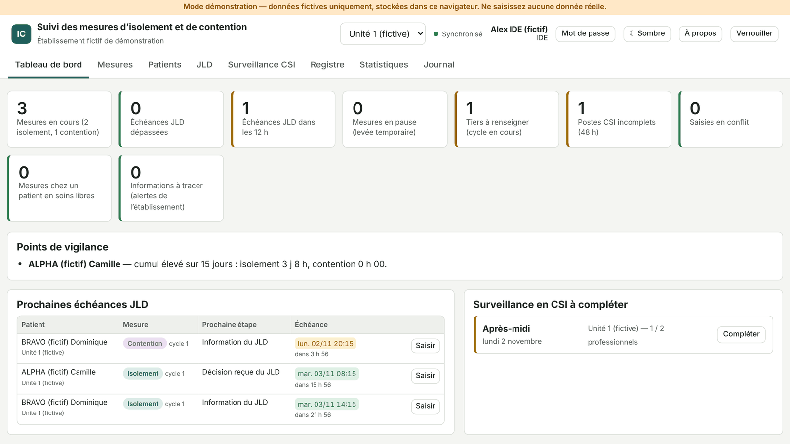

*En haut à droite : le service affiché, votre nom, le bouton clair / sombre et « Verrouiller ».*

## 3. Créer une mesure

Onglet **Mesures** → **+ Nouvelle mesure**, dès que le psychiatre a décidé la mesure.

1. **Patient** : choisissez-le dans la liste, ou *+ Nouveau patient* (IPP, nom, prénom et **date de naissance obligatoire**).
2. **Mode d'hospitalisation** : vérifiez-le (SDT, SDRE, SPI…).
3. **Type de mesure** : isolement ou contention ; **date et heure de la décision** du psychiatre (et non l'heure de la saisie).
4. **Psychiatre décisionnaire** et **lieu** (CSI ou chambre).
5. **Enregistrer**.

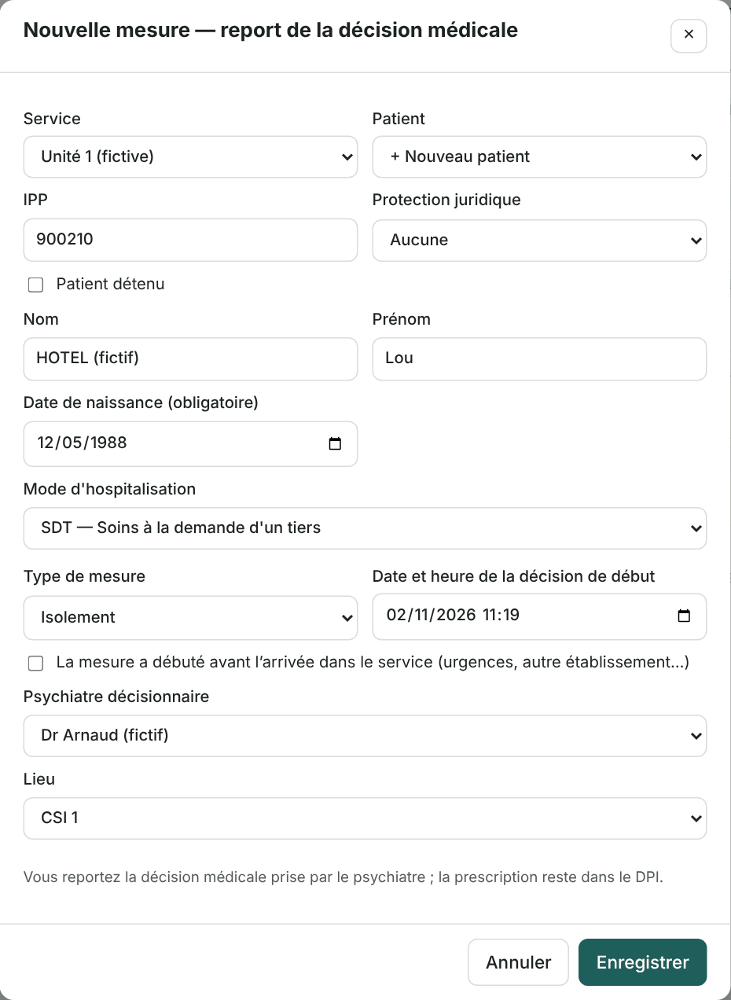

*Les messages en rouge sous les champs sont des alertes (patient mineur, soins libres, contention hors CSI, mesure déjà en cours…) : lisez-les, elles n'empêchent pas l'enregistrement.*

**Contention en CSI** : l'outil propose de créer en même temps l'isolement qui l'accompagne (case cochée). **Contention hors CSI** : cochez l'exception seulement si elle est prévue par le plan de soins (contention ambulatoire).

La mesure apparaît dans la liste, avec ses trois échéances JLD : *Info avant* (information du juge), *Saisine avant*, *Décision avant*.

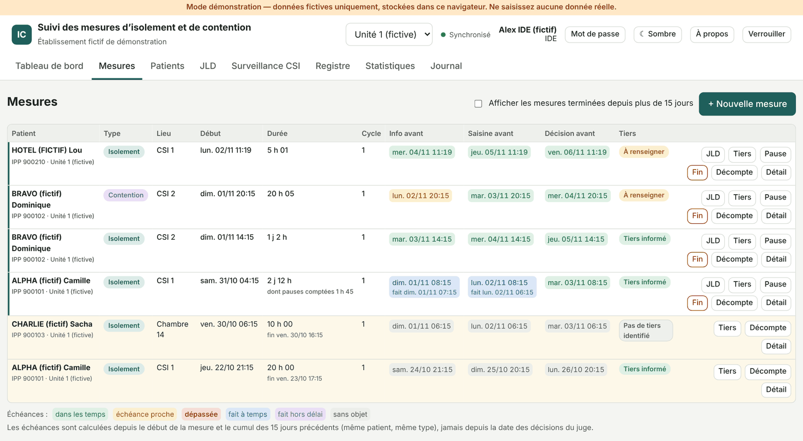

*Couleurs des échéances : vert = dans les temps, orange = proche, rouge = dépassée, bleu = fait à temps, violet = fait hors délai.*

## 4. Pause (levée temporaire) et reprise

Pour un repas, une douche, une visite… décidés par le psychiatre : bouton **Pause** sur la ligne de la mesure.

- **Début de la pause** (heure réelle), puis **pour une durée** (raccourcis 30 min, 1 h, 2 h, 4 h) **ou jusqu'à une heure** de reprise ;
- **motif** et **psychiatre décisionnaire** ;
- **Enregistrer la pause**.

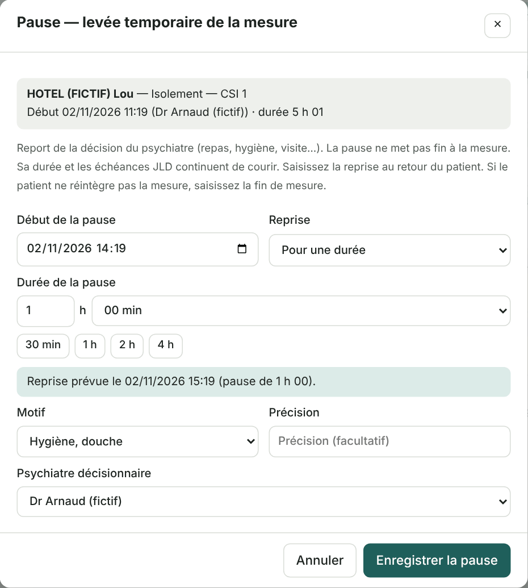

*La pause ne met pas fin à la mesure. Selon la règle de votre établissement, sa durée reste comptée dans le cumul (cas par défaut) ou en est déduite.*

Pendant la pause, la ligne indique l'heure de reprise prévue et le bouton **Reprise** apparaît.

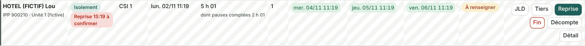

Au retour du patient : **Reprise** → heure réelle de reprise → **Enregistrer la reprise**. Si le psychiatre décide de ne pas reprendre la mesure, fermez cette fenêtre et utilisez **Fin** (paragraphe 8).

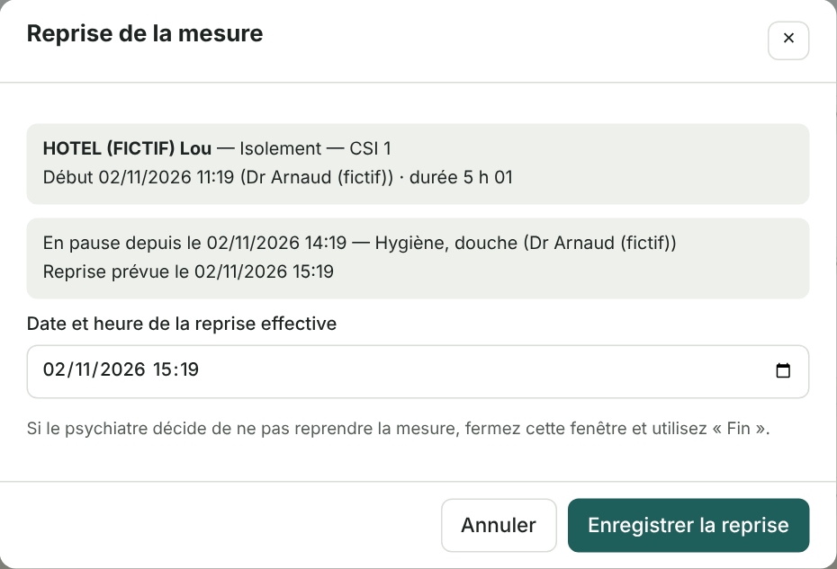

## 5. Information du tiers

À **chaque cycle** de contrôle, un proche (famille, personne de confiance…) doit être informé du renouvellement, en même temps que le juge. Bouton **Tiers** sur la ligne :

- **Résultat** (tiers informé, tentative sans succès, pas de tiers identifié, refus du patient…) ;
- **qualité** du tiers (conjoint, parent…), **qui a informé** (le psychiatre, ou la fonction prévue par l'établissement), **date et heure** ;
- **Enregistrer**.

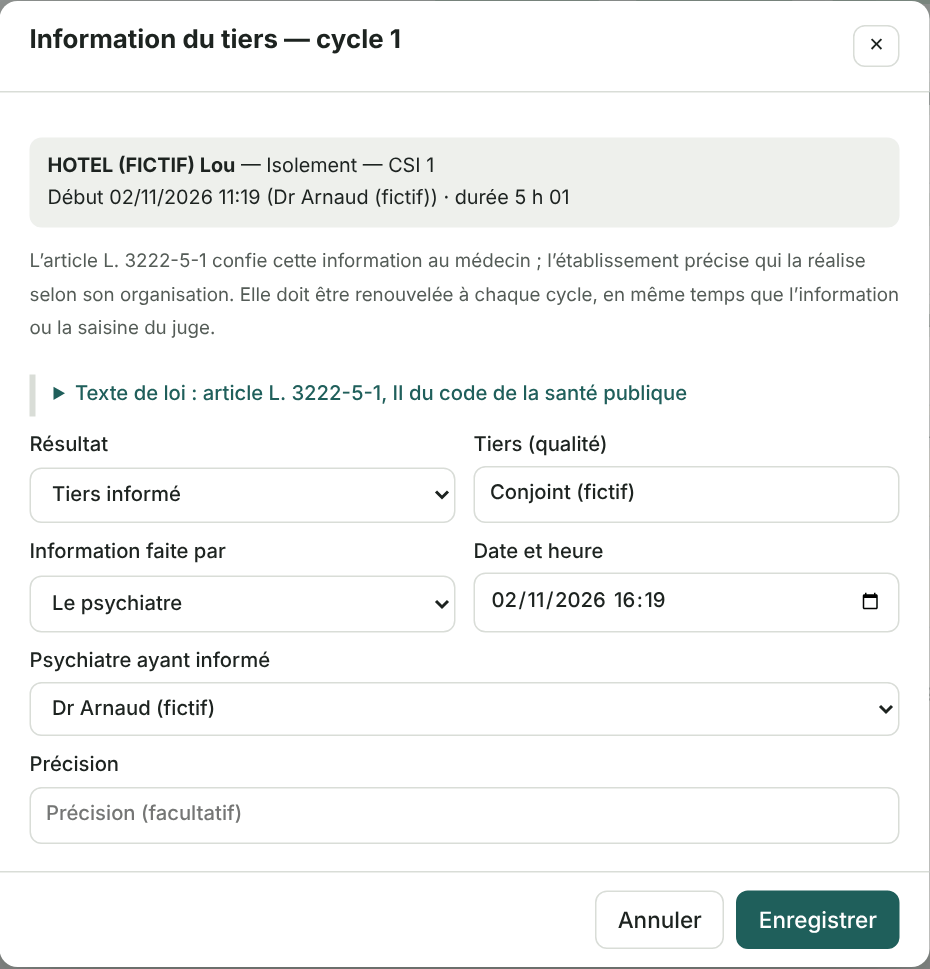

*Tant que rien n'est enregistré pour le cycle, la colonne « Tiers » indique « À renseigner » ; dans l'onglet JLD : « Proche à informer avant le…, comme le juge ». Pour un patient sous tutelle ou curatelle, informez aussi le tuteur ou le curateur.*

## 6. Le décompte JLD et la traçabilité de l'envoi

### 6.1 Produire le décompte

Bouton **Décompte** sur la ligne de la mesure. L'aperçu reprend l'identité, la période analysée (15 jours glissants), chaque mesure, les pauses et le cumul, à la date et l'heure de référence (en général : maintenant).

- **Enregistrer en PDF** : le fichier est créé directement, à **enregistrer sur le réseau de l'établissement** (jamais sur une clé USB ou un poste personnel) puis à joindre à la communication au juge selon la procédure du service ;
- **Imprimer** : si un envoi papier est nécessaire.

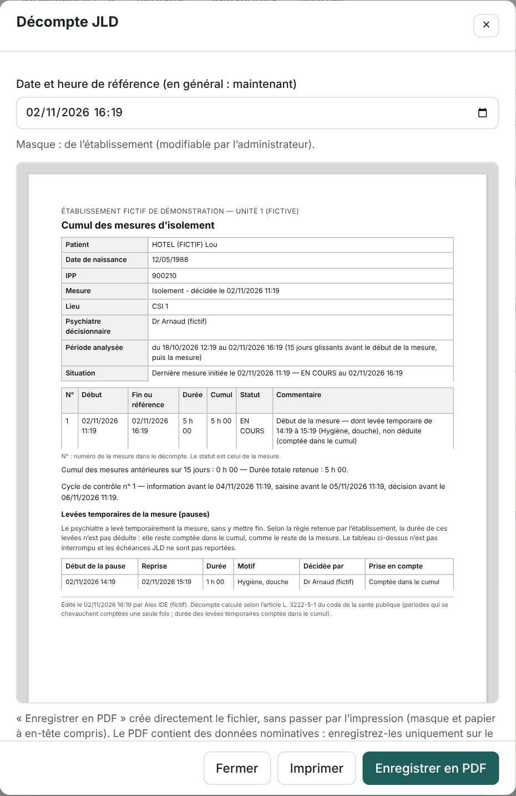

*Le document contient des données nominatives.*

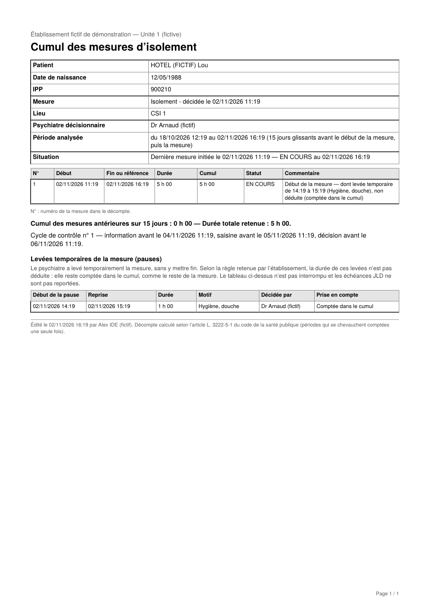

*Première page du PDF produit (mise en page selon le modèle de votre établissement).*

### 6.2 Tracer l'envoi

Une fois l'envoi fait (information du juge, saisine) ou la décision reçue : onglet **JLD** → **Saisir un envoi ou une décision** sur la ligne du patient. Les mesures sont classées par urgence.

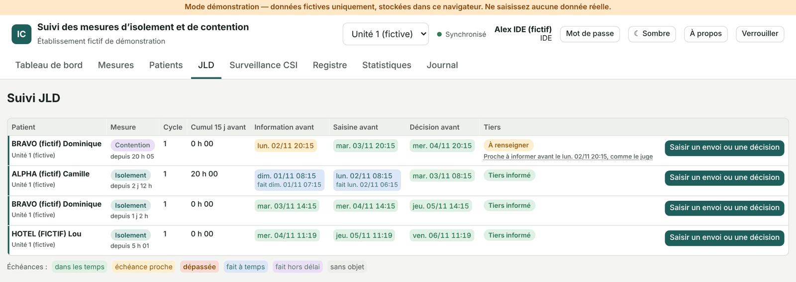

Dans la fenêtre : la **nature** (*Information du JLD*, *Saisine du JLD* ou *Décision reçue du JLD*, avec alors maintien ou levée), la **date et l'heure réelles** de l'envoi, puis **Enregistrer**.

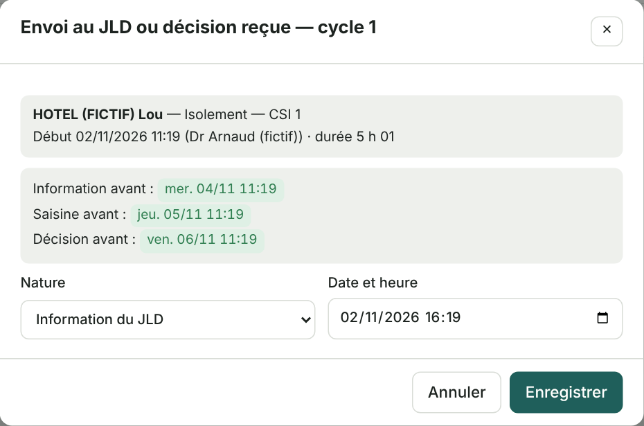

L'échéance passe en bleu, avec la mention « fait le … » : l'envoi est tracé.

*Une décision de **maintien** ouvre automatiquement le cycle suivant, avec de nouvelles échéances (et un nouveau tiers à informer). Une **mainlevée** du juge ne termine pas la mesure : la fin reste une décision médicale.*

## 7. Suivi de la CSI : professionnels chargés de la surveillance

Le registre légal doit indiquer les professionnels qui ont assuré la surveillance. Onglet **Surveillance CSI** : chaque poste (matin, après-midi, nuit) couvert par une mesure en CSI a deux emplacements ; un poste incomplet est signalé (« À renseigner », liseré orange) et compté au tableau de bord.

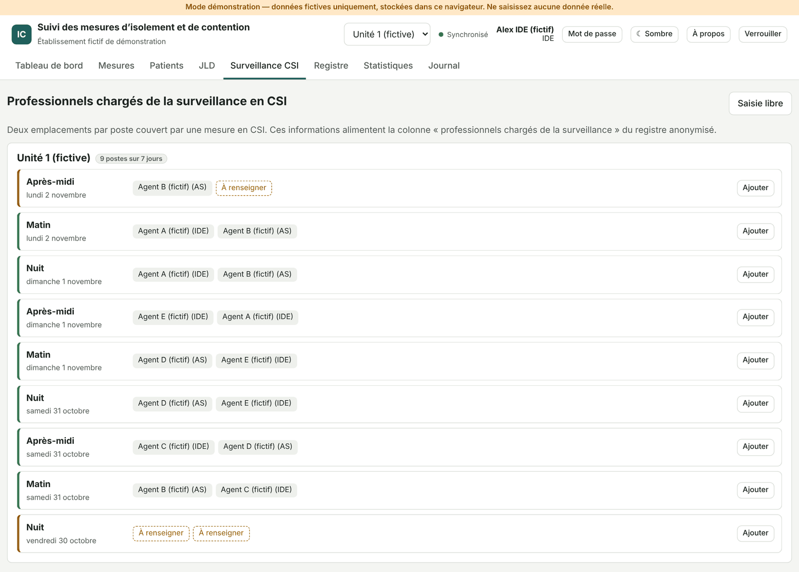

**Ajouter** sur la ligne du poste → **nom** et **fonction** (IDE, AS…) → **Enregistrer**, ou **Enregistrer et ajouter un autre** pour le second professionnel.

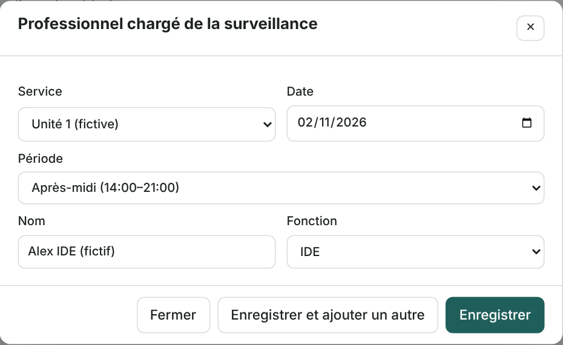

*À faire à chaque poste, de préférence avant la relève.*

## 8. Fin de la mesure

Quand le psychiatre lève la mesure : bouton **Fin** → **date et heure de la décision**, **psychiatre**, **motif de fin** → **Enregistrer la fin**.

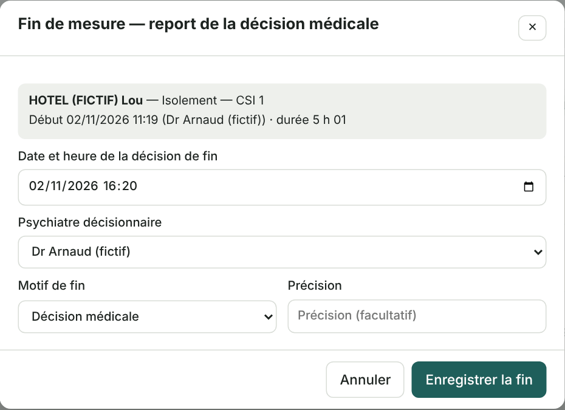

La ligne passe en « terminée » ; la mesure entre au registre et reste visible 15 jours dans la liste (case *Afficher les mesures terminées…* pour les plus anciennes).

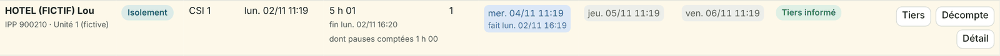

*Si le patient est remis en isolement ou en contention ensuite, c'est une **nouvelle mesure** : le cumul des 15 jours en tient compte automatiquement.*

## 9. En cas d'erreur de saisie

Bouton **Détail** sur la ligne : tout l'historique de la mesure, saisie par saisie, avec son auteur. **Proposer une correction…** permet de signaler une erreur (heure, lieu…) avec un motif ; le cadre de santé la valide ou la refuse. Rien n'est jamais effacé.

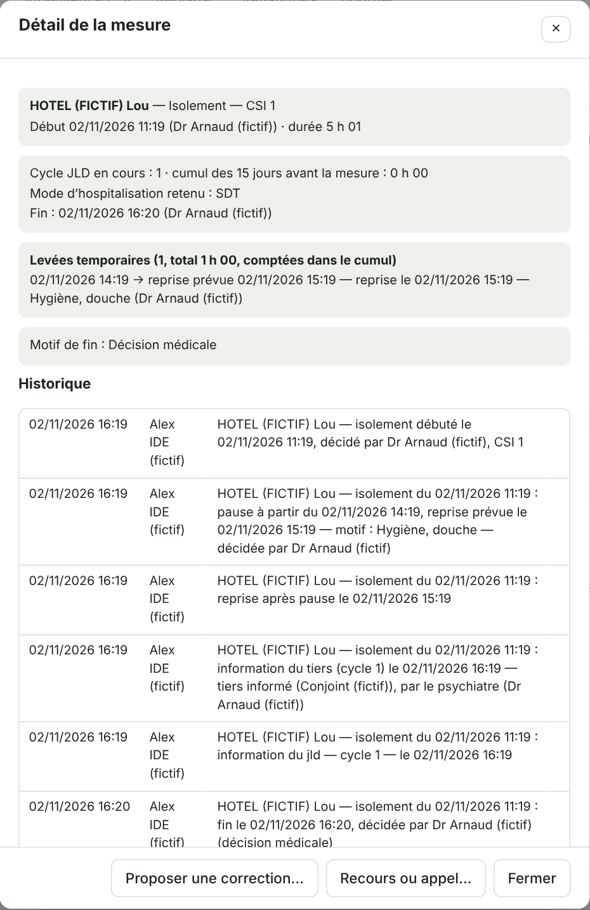

## Mémo — qui fait quoi, quand

| Situation | Où | Bouton |
| --- | --- | --- |
| Le psychiatre décide une mesure | Mesures | **+ Nouvelle mesure** |
| Repas, douche, visite (décidés par le psychiatre) | Mesures, ligne du patient | **Pause**, puis **Reprise** |
| Un proche est informé (à chaque cycle) | Mesures, ligne du patient | **Tiers** |
| Pièce à joindre à l'envoi au juge | Mesures, ligne du patient | **Décompte** → **Enregistrer en PDF** |
| Information ou saisine envoyée, décision reçue | JLD | **Saisir un envoi ou une décision** |
| Début de chaque poste en CSI | Surveillance CSI | **Ajouter** (deux professionnels) |
| Le psychiatre lève la mesure | Mesures, ligne du patient | **Fin** |
| Erreur de saisie | Mesures → **Détail** | **Proposer une correction…** |

**Toujours** : les heures saisies sont celles des **décisions et des faits**, pas l'heure de la saisie. Une saisie oubliée se fait à son heure réelle, même plus tard.

**En cas de panne** de l'outil ou du réseau : fiche papier de la procédure dégradée (procédures de secours, document 04), à ressaisir dès le retour de l'outil.
